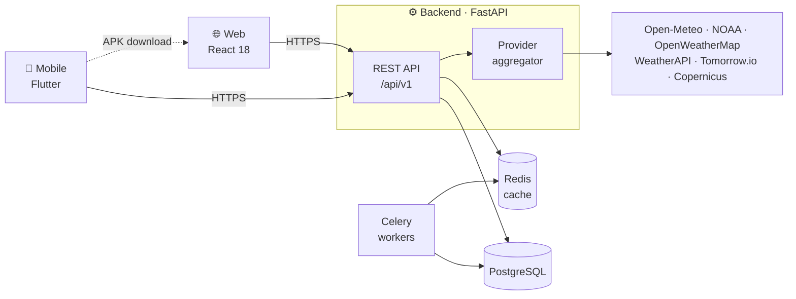

<div align="center">

<br>


<br>

**Real-time weather intelligence from six providers**<br>
Aggregated data · Smart insights · Live updates · Open source

<p>
<a href="RELEASES.md#v200"></a>


</p>

<p>


</p>

<a href="https://getweatherly.vercel.app"></a>
<a href="https://getweatherly.vercel.app/apk"></a>

<br>
<br>

[Components](#components) · [Quick start](#quick-start) · [Architecture](#architecture) · [Data providers](#data-providers) · [Documentation](#documentation) · [Changelog](CHANGELOG.md) · [Release notes](RELEASES.md)

---

</div>

# Weatherly

Weatherly is a full-stack weather intelligence platform. It aggregates data from six providers, caches it intelligently, and delivers the same experience on the web and as a native Android app.

> **v2.0.0** is a complete rewrite of the v1.0.0 stack. See the **[release notes](RELEASES.md#v200)** for what changed and how to upgrade, and the **[changelog](CHANGELOG.md)** for the full list.

## Components

### ⚙️ Backend · `/backend`

Python / FastAPI service.

- Aggregates six weather providers with automatic failover
- Redis caching, with targets of ≥ 85 % hit rate and sub-50 ms cached responses
- PostgreSQL (SQLAlchemy, Alembic) for locations and alerts
- Celery workers for cache warming and alert ingestion
- Rate limiting, security headers, request IDs and CORS built in
- Publishes the update manifest that powers in-app Android updates

### 🌐 Web · `/web`

React 18 + Vite + TailwindCSS single-page app.

- React Query for server state, Zustand for persisted preferences
- Framer Motion transitions and the DynamicSky background engine
- GPS → browser → IP location detection with accuracy scoring
- Hosts the Android download page (`/apk`) and release history (`/apk/releases`)

### 📱 Mobile · `/mobile`

Flutter app for Android.

- Mirrors the web experience on the same `/api/v1` contract
- Custom-painted sky, charts, gauges and alert radar, tuned for 60 fps
- Shows the last known weather when offline
- Checks for updates on launch and installs them in-app, with SHA-256-verified downloads

## Quick start

### Docker Compose (backend + web)

```bash
docker-compose up -d
```

| Service | URL |
|:--------|:----|
| Web app (nginx) | http://localhost |
| Backend API | http://localhost:8000 |
| API docs (non-production only) | http://localhost:8000/docs |

### Manual setup

Each component has its own setup guide:

- **[Backend](backend/Readme.md#-quick-start)** — Python / FastAPI
- **[Web](web/README.md#-quick-start)** — React / Vite
- **[Mobile](mobile/README.md#-quick-start)** — Flutter / Android

The mobile app needs a running backend. It reads the API address from a compile-time define, not from `.env`:

```bash
cd mobile
flutter pub get

# Android emulator talking to a backend on your computer
flutter run --dart-define=API_URL=http://10.0.2.2:8000

# Release build against your deployed backend
flutter build apk --release --dart-define=API_URL=https://<your-backend>
```

## Architecture



## Data providers

At least one keyed provider is recommended. Open-Meteo and NOAA work without a key and are always active.

| Provider | Free tier | Key required |
|:---------|:----------|:------------:|
| [Open-Meteo](https://open-meteo.com/) | Unlimited | — |
| [NOAA](https://www.weather.gov/documentation/services-web-api) | Unlimited | — |
| [OpenWeatherMap](https://openweathermap.org/api) | 1,000 / day | ✓ |
| [WeatherAPI](https://www.weatherapi.com/) | 1 M / month | ✓ |
| [Tomorrow.io](https://www.tomorrow.io/weather-api/) | 500 / day | ✓ |
| [Copernicus](https://atmosphere.copernicus.eu/) | Free | ✓ (marine and environmental only) |

## Documentation

| Guide | Covers |
|:------|:-------|
| [Backend](backend/Readme.md) | API reference, environment variables, deployment, security |
| [Web](web/README.md) | Features, structure, API integration, deployment, accessibility |
| [Mobile](mobile/README.md) | Features, Dynamic Sky engine, structure, release workflow |
| [Release notes](RELEASES.md) | Highlights, install guide, breaking changes, migration |
| [Changelog](CHANGELOG.md) | Every change per version ([Keep a Changelog](https://keepachangelog.com/en/1.1.0/)) |

## Versions

| Version | Released | Status | Summary |
|:--------|:---------|:-------|:--------|
| **[2.0.0](RELEASES.md#v200)** | 2026-10-11 | Current | Full rewrite: FastAPI backend, React web, Flutter app, six providers, in-app updates |
| [1.0.0](RELEASES.md#v100) | 2025-10-08 | Legacy | Flask + OpenWeatherMap, vanilla JS web, first Flutter app |

## Project structure

```
weatherly-new/code/
├── backend/                 # FastAPI service
│   ├── app/
│   │   ├── api/             # Route definitions
│   │   ├── core/            # Configuration and utilities
│   │   ├── models/          # SQLAlchemy models
│   │   ├── schemas/         # Pydantic schemas
│   │   ├── services/        # Business logic and provider integrations
│   │   └── tasks/           # Celery tasks
│   ├── migrations/          # Alembic migrations
│   ├── tests/
│   ├── requirements.txt
│   ├── Dockerfile
│   └── Readme.md
├── web/                     # React + Vite app
│   ├── public/
│   │   └── apk/releases/    # Published APKs and releases.json
│   ├── src/
│   │   ├── api/  assets/  components/  hooks/  lib/  pages/  utils/
│   │   ├── App.jsx
│   │   └── main.jsx
│   ├── vercel.json          # SPA rewrites and APK headers
│   └── README.md
├── mobile/                  # Flutter app
│   ├── android/             # Native project (installer channel, FileProvider)
│   ├── assets/
│   ├── lib/
│   │   ├── api/  stores/  providers/  services/  models/
│   │   ├── utils/  theme/  components/  pages/
│   │   ├── app.dart
│   │   └── main.dart
│   ├── pubspec.yaml
│   └── README.md
├── scripts/
│   └── release-apk.ps1      # Hash an APK, update releases.json, print backend env vars
├── docker-compose.yml
├── CHANGELOG.md
├── RELEASES.md
└── LICENSE
```

## Contributing

Contributions are welcome. Please follow the guidelines in each component's README.

1. Fork the repository
2. Create a feature branch: `git checkout -b feature/amazing-feature`
3. Commit your changes: `git commit -m "Add some amazing feature"`
4. Push the branch: `git push origin feature/amazing-feature`
5. Open a pull request

Match the existing code style and add tests for new features.

## Support

[](#documentation)
[](https://github.com/srinathnulidonda/weatherly/issues)
[](https://github.com/srinathnulidonda/weatherly/issues)
[](mailto:srinathnulidonda.dev@gmail.com)

## Credits

Weather data from [Open-Meteo](https://open-meteo.com/), [NOAA](https://www.weather.gov/), [OpenWeatherMap](https://openweathermap.org/), [WeatherAPI](https://www.weatherapi.com/), [Tomorrow.io](https://www.tomorrow.io/) and [Copernicus](https://atmosphere.copernicus.eu/). Hosted on [Vercel](https://vercel.com/) and [Render](https://render.com/).

## License

Released under the MIT License. See [LICENSE](LICENSE).

<br>

<div align="center">


<sub>Built with FastAPI · PostgreSQL · Redis · Celery · React · Vite · TailwindCSS · Flutter</sub><br>
<sub>MIT License © 2025–2026 Srinath Nulidonda</sub>

</div>