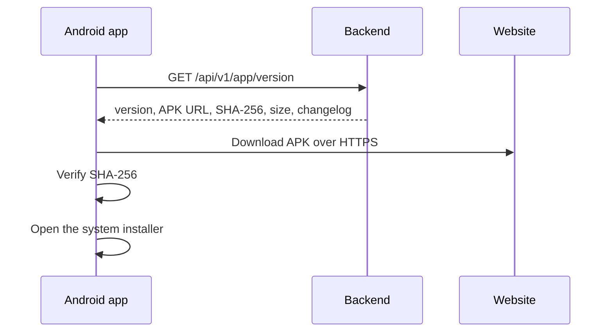

# Release Notes

Narrative notes for each version. For the exhaustive list of changes, see [CHANGELOG.md](CHANGELOG.md).

**[v2.0.0 — current](#v200)** · [v1.0.0 — legacy](#v100)

---

## v2.0.0

<div align="center">


### Full rewrite — multi-provider weather intelligence

*A rebuilt stack: new backend, new web app, new mobile app.*

</div>

### Download

| Platform | Get it | Details |
|:---------|:-------|:--------|
| 🌐 **Web app** | [getweatherly.vercel.app](https://getweatherly.vercel.app) | Any modern browser |
| 📱 **Android** | [Download page](https://getweatherly.vercel.app/apk) · [APK](https://getweatherly.vercel.app/apk/releases/weatherly-2.0.0.apk) | ~19 MB · Android 6.0+ · SHA-256 on the download page |

<details>
<summary><b>Installing the APK</b></summary>

1. Open the [download page](https://getweatherly.vercel.app/apk) on your phone and tap **Download APK**.
2. When Android asks, allow installs from your browser (one-time permission).
3. Open the downloaded file and confirm. If Play Protect warns about an app from outside the Play Store, choose **Install anyway**.
4. Optional: compare the file's SHA-256 with the checksum on the download page.

</details>

### Highlights

<table>
<tr>
<td width="50%" valign="top">

**🔁 Six providers, one API**<br>
<sub>Open-Meteo, NOAA, OpenWeatherMap, WeatherAPI, Tomorrow.io and Copernicus, with automatic failover when one is down.</sub>

**⚡ Fast by design**<br>
<sub>Redis caching targets sub-50 ms cached responses, and Celery workers keep the hot set warm.</sub>

**🧠 Analytics engine**<br>
<sub>Trends, activity indices, condition insights, location comparison and alert statistics.</sub>

</td>
<td width="50%" valign="top">

**🎨 Two dynamic sky engines**<br>
<sub>CSS gradient stops on the web, a custom painter on mobile. Both follow the real solar arc and current conditions.</sub>

**🔄 In-app Android updates**<br>
<sub>The app finds new releases itself, downloads the APK and verifies its SHA-256 before opening the installer.</sub>

**🚀 Smooth at 60 fps**<br>
<sub>Static sky painter, scroll-aware animation tickers, isolated repaint layers and no nested scroll views.</sub>

</td>
</tr>
</table>

### In-app updates



- The app checks once per launch, after the splash screen.
- **Later** skips that release. The prompt returns with the next one.
- Updates can be made mandatory with a minimum version or a force flag on the backend.
- Android only installs an update that is signed with the same key as the installed app. Always sign releases with the same keystore.

### What's new

**Backend** — Flask → FastAPI. Multi-provider aggregation with failover, a full analytics API, air quality, astronomy, map tiles, marine and environmental data, Celery workers, observability and security middleware, and the update manifest.

**Web** — Vanilla JS → React. Zustand and React Query state, DynamicSky, drag-to-reorder location pager, Analytics and Alerts pages, legal pages, error boundaries, skeleton loaders, offline banner, and the Android download and release-history pages.

**Mobile** — A new Flutter app. Provider architecture, custom-painted charts (temperature, AQI gauge, wind compass, sun arc), alert radar, a 14-rule smart advisory engine, animated splash, bottom navigation and tablet sidebar, offline last-known weather, and in-app updates.

### API at a glance

All endpoints live under `/api/v1`.

| Area | Endpoints |
|:-----|:----------|
| **Weather** | `/weather/current` · `/weather/forecast` (1–16 days, optional hourly) · `/weather/history` (30 days) · `/weather/alerts` · `/weather/air-quality` · `/weather/maps` · `/weather/astronomy` |
| **Analytics** | `/analytics/trends` (1–168 h) · `/analytics/compare` (2–5 locations) · `/analytics/indices` · `/analytics/insights` · `/analytics/alert-stats` |
| **Marine** | `/marine/ocean` · `/marine/tides` · `/marine/agriculture` · `/marine/environmental` |
| **Locations** | `/locations/search` |
| **App** | `/app/version` |
| **System** | `/health` · `/health/detailed` and `/metrics` (API key) |

### Breaking changes

**Backend**

- Flask → FastAPI. All endpoints now live under `/api/v1`.
- Successful responses use a `data` envelope with a `message`. Errors are `{ "error": true, "error_code": "...", "message": "...", "details": {...} }`.
- Alerts are paginated, and the response includes a `pagination` object.
- Rate limiting is now one per-IP limit, configurable with `RATE_LIMIT_PER_MINUTE` (default 120). It replaces the per-endpoint limits of 30 / 20 / 10.
- `/api/v1/weather/{city}` is removed. Search with `/api/v1/locations/search?q=...`, then call `/api/v1/weather/current?lat=...&lon=...`.

**Web**

- The app is now a single-page app. Routes are `/`, `/forecast`, `/search`, `/analytics`, `/alerts`, `/settings`, `/apk` and `/legal/*`. Old multi-page URLs such as `/about.html` are gone.
- Preferences stored under the v1.0.0 localStorage keys are ignored, so users start fresh.

**Mobile**

- The package ID changed from `com.example.weather` to `com.sn.weatherly`. Android treats it as a different app, so v1.0.0 users must install v2.0.0 fresh. Their saved data does not carry over.
- The v1.0.0 screens (`splash_screen`, `home_screen`, `settings_screen`, `about_screen`) and the local notification manager are removed. Alerts now appear in the Alerts page and the home-screen banner.

<details>
<summary><b>Migration guide</b></summary>

#### Calling the v1.0.0 API

| v1.0.0 | v2.0.0 |
|:-------|:-------|
| `GET /api/v1/weather/London` | `GET /api/v1/locations/search?q=London`, then `GET /api/v1/weather/current?lat=…&lon=…` |
| `GET /api/v1/weather/coordinates?lat=X&lon=Y` | `GET /api/v1/weather/current?lat=X&lon=Y` |
| `GET /api/v1/forecast/London` | `GET /api/v1/weather/forecast?lat=X&lon=Y&days=7` |
| `POST /api/v1/weather/bulk` | Loop over `/weather/current`, or use `/analytics/compare` |
| `Authorization: Bearer …` | `X-API-KEY: …` (only enforced when the `API_KEY` environment variable is set) |

#### Running the stacks

The v1.0.0 sources are preserved under the `v1.0.0` tag.

```bash
git checkout v1.0.0     # the old Flask stack
git checkout main       # v2.0.0
docker-compose up -d
```

#### Production configuration

With `ENVIRONMENT=production` the backend refuses to start unless `API_KEY` is set, `ALLOWED_HOSTS` lists explicit hostnames, and `CORS_ORIGINS` is not `*`.

</details>

### Performance targets

| Metric | Web | Mobile | Backend |
|:-------|:----|:-------|:--------|
| First contentful paint | < 1.2 s | — | — |
| App launch | — | < 2 s | — |
| Time to first weather | < 1.5 s | < 3 s | — |
| Cached API response | — | — | < 50 ms |
| Uncached API response | — | — | < 500 ms |
| Frame budget | 16 ms | 16 ms | — |
| Cache hit rate | — | — | ≥ 85 % |
| APK size | — | ~19 MB | — |

### Known limitations

- Android only. There is no iOS build.
- The APK is distributed outside the Play Store, so Play Protect may show a warning on first install.

[Report a bug](https://github.com/srinathnulidonda/weatherly/issues) · [Request a feature](https://github.com/srinathnulidonda/weatherly/issues) · [Email](mailto:srinathnulidonda.dev@gmail.com)

**[⬆ Back to top](#release-notes)**

---

## v1.0.0

> **Superseded by [v2.0.0](#v200).** Kept for reference. The `v1.0.0` tag preserves the original Flask backend, vanilla JS web app and first Flutter app.


*Initial public release: the first weather experience across web and mobile.*

| Platform | Link | Size |
|:---------|:-----|:-----|
| 🌐 Web | [getweatherly.vercel.app](https://getweatherly.vercel.app/) | — |
| 📱 Android | [APK v1.0.0](https://drive.google.com/uc?export=download&id=10lPOkrf2HACA6ht-cirq_ubcW6adB_W2) | ~50 MB |

What shipped and the limitations that v2.0.0 addresses are listed under [1.0.0 in the changelog](CHANGELOG.md#100--2025-10-08-legacy). To move to v2.0.0, follow the [migration guide](#v200).

**[⬆ Back to top](#release-notes)**

<sub>MIT License © 2025–2026 Srinath Nulidonda</sub>